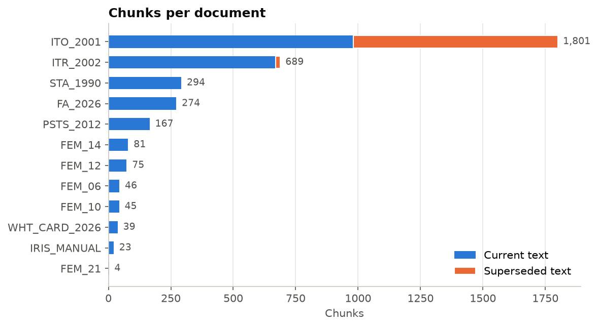
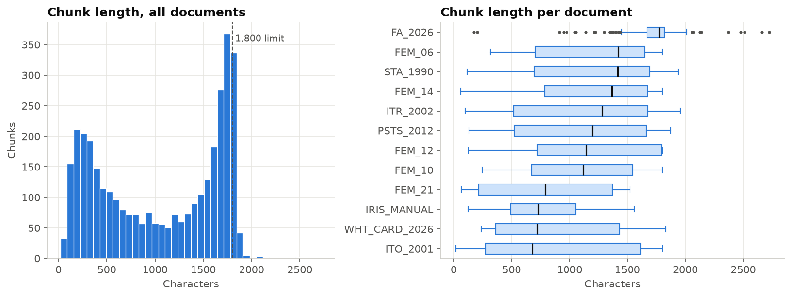
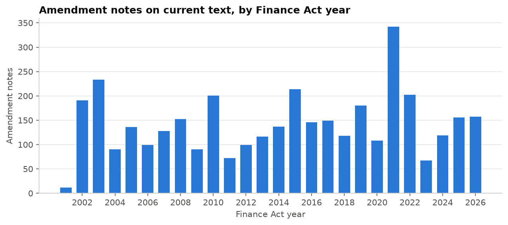
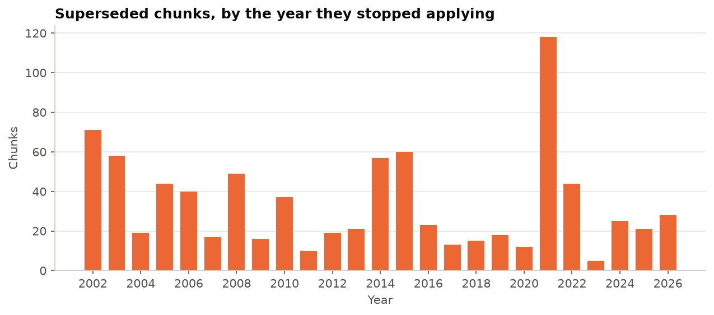
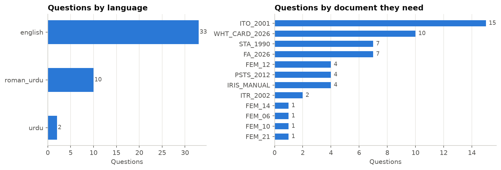
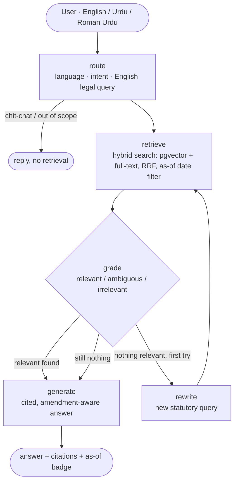

# TaxChronos

A time-aware, self-correcting RAG system for Pakistani tax law. Ask in English, Urdu or Roman Urdu; get an answer grounded in the statute, with section-level citations, amendment history and the date the law was in force.

**Group:** Muhammad Abdullah Haroon (23L-0734), Khadija Fatima (23L-0976), Hussain Farhan (23L-2521)

## Problem statement

Pakistani tax law is spread over long statutes that are amended every year by a Finance Act. The official PDFs are hundreds of pages each, the current wording and the old wording sit together in footnotes, and most people ask their questions in Urdu or Roman Urdu while the law is in English. A general chatbot answers these questions from memory, so it gives rates that are out of date and cannot say where they come from.

TaxChronos answers a tax question from the text of the law itself: it finds the relevant sections, answers in the user's language, cites each section, and can answer for a past date ("what was the rate in January 2021?").

## Phase 1: the data

This is a retrieval project, so the dataset is a **text corpus**, not a table. There is no target variable and nothing to scale; the equivalent work is parsing, cleaning and chunking the documents, then checking the result. The full report, with outputs, is [`notebooks/data_report.ipynb`](notebooks/data_report.ipynb).

### Dataset

| | |
|---|---|
| Raw data | 12 official PDFs, 2,773 pages, 146 MB |
| Cleaned data | [`data/processed/`](data/processed), 12 JSON files, 3,538 chunks, 5.4 MB |
| Record | one chunk of law (a section, rule, paragraph or table piece) |
| Features | `id`, `source`, `title`, `section`, `page`, `content`, `amendments`, `effective_from`, `effective_to` |
| Target variable | none. The system retrieves and cites; it does not predict a label |
| Evaluation set | [`eval/codeswitch_eval_set.jsonl`](eval/codeswitch_eval_set.jsonl), 45 hand-written questions with reference answers (33 English, 10 Roman Urdu, 2 Urdu) |

The raw PDFs are too large for the repo. Download them into `data/raw/` with the file names below:

| Id | Document | Pages | Chunks | Source |
|---|---|---|---|---|
| `ITO_2001` | Income Tax Ordinance, 2001 | 839 | 1,801 | [fbr.gov.pk](https://www.fbr.gov.pk), saved as `IncomeTaxOrdinance2001.pdf` |
| `ITR_2002` | Income Tax Rules, 2002 | 1,198 | 689 | [download](https://download1.fbr.gov.pk/Docs/20269211394336470IncomeTaxRules2002.pdf) |
| `STA_1990` | Sales Tax Act, 1990 | 229 | 294 | [download](https://download1.fbr.gov.pk/Docs/20267171373418951SalesTaxAct1990updatedupto30.06.2026.pdf) |
| `FA_2026` | Finance Act, 2026 | 256 | 274 | [download](https://download1.fbr.gov.pk/Docs/20266291261044366FinanceAct2026.pdf) |
| `PSTS_2012` | Punjab Sales Tax on Services Act, 2012 | 100 | 167 | [pra.punjab.gov.pk](https://pra.punjab.gov.pk), saved as `punjab-sales-tax-on-services-act-2012-pdf2.pdf` |
| `WHT_CARD_2026` | FBR Withholding Tax Rate Card | 18 | 39 | [download](https://download1.fbr.gov.pk/Docs/202681113864992WithholdingTaxRatesCard2027.pdf) |
| `FEM_06`, `FEM_10`, `FEM_12`, `FEM_14`, `FEM_21` | SBP Foreign Exchange Manual, chapters 6, 10, 12, 14, 21 | 110 | 251 | [sbp.org.pk/fe_manual](https://www.sbp.org.pk/fe_manual/index.htm) |
| `IRIS_MANUAL` | FBR IRIS 2.0 Return Filing Manual | 23 | 23 | [fbr.gov.pk](https://www.fbr.gov.pk), saved as `IRIS_Return_Manual.pdf` |

The exact file name each document needs is in [`sources.json`](sources.json). You do not need the PDFs to run the notebook: it reads the cleaned data that is already in the repo.

### Cleaning steps

All cleaning is done by [`ingestion/parse.py`](ingestion/parse.py), configured per document in `sources.json`:

| Problem in the raw PDFs | How it is handled |
|---|---|
| Cover pages and tables of contents | skipped, using the first and last body page set for each document |
| Running headers, gazette banners, page numbers | removed with a pattern per document |
| Scanned pages with no text (252 pages in 5 documents) | transcribed once, saved in `data/transcripts/`, and reused |
| Footnote markers inside the text | separated from the body and stored on the chunk as `amendments` |
| Old wording quoted in footnotes | stored as its own chunk, marked superseded, with the date it stopped applying |
| Tables | converted to Markdown rows, with the header repeated on every piece |
| Sections of very different length | split into pieces of at most 1,800 characters |
| Fragments with almost no text | dropped |
| Duplicates | chunk ids are content hashes, so identical chunks collapse into one |

The notebook then audits the result:

| Check | Result |
|---|---|
| Missing values | none, except `effective_to`, which is empty by design for law still in force |
| Duplicate ids | 0 |
| Duplicate text | 2 superseded passages stored twice with different end dates (known issue) |
| Outliers in length | bounded by the 1,800 limit; 2 fragments under 50 characters (known issue) |
| Formats | all dates are ISO, no reversed date ranges, pages are integers, no broken characters |

**Normalization and scaling** do not apply: there are no numeric features. Text is not lowercased or stemmed either, because in a statute `154A` and `154` are different sections and `shall` and `may` mean different things.

### Key findings

**1. The corpus is very imbalanced.** The Income Tax Ordinance is half of all chunks, and with the Income Tax Rules it is 70%. The smallest document is 4 chunks. Small documents can be crowded out in retrieval, so results have to be checked per document.



**2. Chunk length has two groups.** Many short chunks (definitions, superseded clauses) and a second group at the 1,800-character limit (long sections that were split). Short chunks carry little context alone, so the section heading is kept with every chunk.



**3. The law changes every year.** Current text carries 4,685 amendment notes, with 2021 the heaviest year. A system that only knows today's text gets past tax years wrong, which is why every chunk has a date range.



**4. History is deep for income tax and thin elsewhere.** 840 chunks (24%) are old wording, covering every year from 2002 to 2026, but 820 of them come from the Income Tax Ordinance. Questions about a past date in other documents will mostly fall back to current text.



**5. The evaluation set is small and mostly English.** Urdu script has only 2 questions, so Urdu scores will not be reliable until more are added. Every document is covered at least once.



### Run the notebook

```bash
pip install -r notebooks/requirements.txt
jupyter nbconvert --to notebook --execute --inplace notebooks/data_report.ipynb
```

Or open `notebooks/data_report.ipynb` in VS Code or Jupyter and run all cells. It rewrites the charts in `images/`.

To rebuild the cleaned dataset from the PDFs:

```bash
pip install -r requirements.txt
python ingestion/parse.py            # data/raw/*.pdf → data/processed/<ID>.json
```

## Architecture



| Layer | Choice | Why |
|---|---|---|
| Orchestration | LangGraph (`pipeline/graph.py`) | The corrective loop is an explicit, inspectable state machine |
| Database | Supabase Postgres with `pgvector` | One system for vectors, full-text and date filters |
| Retrieval | `hybrid_search()` SQL function (`db/schema.sql`) | Dense finds meaning, full-text finds `154A` and `0.25%`, and RRF fuses both |
| Embeddings | `gemini-embedding-001`, 768-d | Multilingual, API-based, so the server stays small |
| Router / grader | `gemini-3.5-flash-lite` | Cheap, fast calls on the hot path |
| Answers | `gemini-3.8-flash`, falls back to `gemini-3.5-flash` on overload | The strongest model, used only for the call that matters |
| API | FastAPI, Server-Sent Events | Streams each graph step to the UI as it happens |
| UI | `frontend/index.html`, served by the API | One deploy, no CORS, no build step |
| Hosting | Render (API + UI), Supabase (data) | Both free tier |

### Corrective (agentic) RAG

The pipeline is Corrective RAG with one rewrite loop. A question costs three LLM calls and one embedding call (five and two if it needs the rewrite):

1. **Route.** One flash-lite call detects the language and intent and turns the question into an English query in statutory vocabulary. This is how Roman Urdu like *"freelancer ki income pe tax kitna"* becomes `income tax rate export proceeds IT services PSEB section 154A`. Greetings never touch retrieval.
2. **Retrieve.** The query is embedded and hybrid search returns 12 candidates, with dense and sparse lists fused by Reciprocal Rank Fusion inside Postgres.
3. **Grade.** One flash-lite call labels every candidate. Only relevant passages (plus ambiguous ones as support, up to 6) reach generation, so grading doubles as reranking.
4. **Rewrite.** If nothing relevant comes back, the query is rewritten once (for example, pointed at the First Schedule for rates) and retrieval runs again.
5. **Generate.** The answer is written in the user's language, every claim cites `[n]`, and amendments are called out by Finance Act. If retrieval found nothing, the answer says so instead of guessing.

### Indexed once, queried forever

Parsing, chunking and embedding happen offline in `ingestion/parse.py` and `indexing/index.py`. The vectors live in Supabase, so the server never loads a PDF: a request embeds one short query and searches. Anyone with the two keys in `.env` runs against the same index without re-indexing. Re-running the indexer only embeds chunks whose content changed.

### Time awareness

The FBR PDF is the consolidated text *as amended up to 30 June 2026*. Its footnotes record each change: *"Substituted by the Finance Act, 2022. The substituted Division read as follows: …"*. The parser uses them in two ways:

- **Current text** is indexed with its amendment notes attached, so answers can say *"changed by Finance Act 2026"*.
- **Superseded text** quoted in a footnote becomes its own chunk with `effective_to = <Finance Act year>-07-01`. 820 historical versions come out of the ITO this way.

`hybrid_search(as_of)` keeps only chunks where `effective_from ≤ as_of < effective_to`. Pick a past date in the UI and you get the law as it stood then. For example, Division IVA was a flat 1% before July 2022.

### Data model

```
chunks   id (sha1 of content) · source · title · section · page · content · amendments[]
         effective_from · effective_to · embedding vector(768) · fts tsvector (generated)
```

Chunk ids are content hashes, so re-indexing is incremental: unchanged chunks are skipped, edited ones are re-embedded, and stale ones are deleted. RLS is on, so the public Supabase API cannot read the table; only the backend's Postgres role can.

## Repository

```
sources.json            registry of documents to ingest
data/processed/         cleaned dataset: one JSON file of chunks per document
notebooks/              data report: cleaning audit, EDA, preprocessing
images/                 charts saved by the notebook
ingestion/parse.py      PDF → section-aware chunks + amendments + superseded versions
data/transcripts/       saved text of scanned pages, reused by the parser
indexing/index.py       migrate schema, embed, upsert into Supabase (resumable)
db/schema.sql           table, indexes, RLS, hybrid_search()
pipeline/graph.py       LangGraph corrective RAG: route, retrieve, grade, rewrite, generate
pipeline/prompts.py     every prompt in one place
pipeline/llm.py         Gemini: embed, ask, model fallback
pipeline/store.py       Postgres: hybrid search
pipeline/naive_baseline.py   dense top-4 → answer (the control group)
api/main.py             FastAPI + SSE + per-IP rate limit
frontend/index.html     chat UI
eval/ragas_suite.py     RAGAS: naive vs crag
render.yaml             Render blueprint
```

## Run it

```bash
pip install -r requirements.txt
cp .env.example .env                 # GOOGLE_API_KEY and DATABASE_URL
uvicorn api.main:app --reload        # http://localhost:8000
```

That is all a teammate needs: the index is already in Supabase. Only when documents change:

```bash
python ingestion/parse.py            # PDF → data/processed/<ID>.json
python indexing/index.py             # embed new chunks → Supabase (resumable)
```

## Deploy

Push to GitHub, create a Render Blueprint from `render.yaml`, and set `GOOGLE_API_KEY` and `DATABASE_URL`. Point a free uptime monitor at `/health` every few minutes: it touches the database, which stops both the Render instance and the Supabase project from going to sleep.

## Adding a document

1. Put the PDF in `data/raw/`.
2. Add an entry to `sources.json` with `id`, `title`, `file`, `effective_from` and `body_starts_at_page` (the first page after the table of contents). The PDF needs a text layer; scanned pages are skipped.
3. Run `python ingestion/parse.py <ID>` and then `python indexing/index.py <ID>`.

## Evaluation

```bash
pip install -r eval/requirements.txt
python eval/ragas_suite.py naive
python eval/ragas_suite.py crag
```

| Pipeline | Faithfulness | Answer relevancy | Context precision | Context recall | p50 latency |
|---|---|---|---|---|---|
| naive | – | – | – | – | – |
| crag | – | – | – | – | – |

## Known limits

- The section heading parser targets Pakistani statute layout. SROs and circulars will likely need their own rules.
- Effective dates come from Finance Act years (1 July). Ordinances that take effect mid-year are approximated.
- The rate limit is held in memory per instance. It's fine for one Render instance; move it to Postgres or Redis if you scale out.
