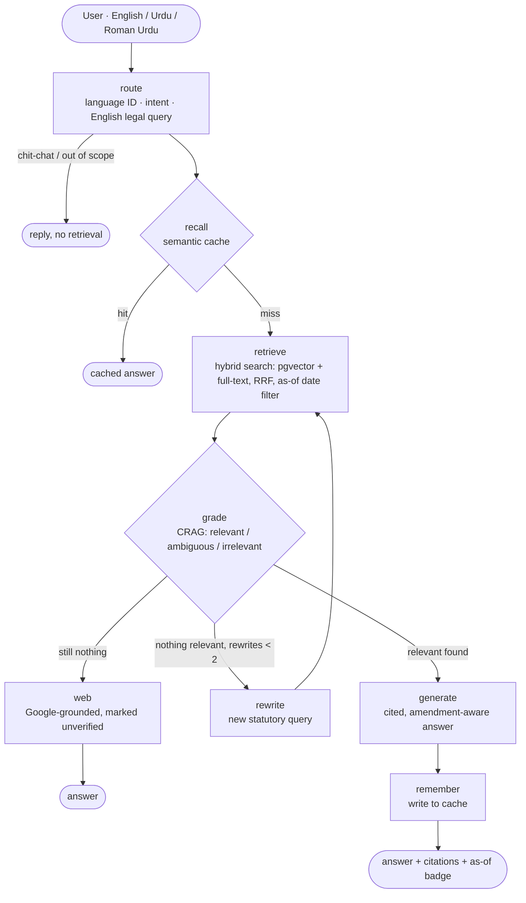

# TaxChronos

A time-aware, self-correcting RAG system for Pakistani tax law. Ask in English, Urdu or Roman Urdu; get an answer grounded in the statute, with section-level citations, amendment history and the date the law was in force.

## Architecture



| Layer | Choice | Why |
|---|---|---|
| Orchestration | LangGraph (`pipeline/graph.py`) | The corrective loop is an explicit, inspectable state machine |
| Database | Supabase Postgres with `pgvector` | One system for vectors, full-text, date filters and cache |
| Retrieval | `hybrid_search()` SQL function (`db/schema.sql`) | Dense finds meaning, full-text finds `154A` and `0.25%`, and RRF fuses both |
| Embeddings | `gemini-embedding-001`, 768-d | Multilingual, API-based, so the server stays small |
| Router / grader | `gemini-3.5-flash-lite` | Cheap, fast calls on the hot path |
| Answers | `gemini-3.8-flash`, falls back to `gemini-3.5-flash` on overload | The strongest model, used only for the call that matters |
| Cache | `answers` table, cosine ≥ 0.92 on the normalized English query | Code-switched variants of one question hit the same entry |
| API | FastAPI, Server-Sent Events | Streams each graph step to the UI as it happens |
| UI | `frontend/index.html`, served by the API | One deploy, no CORS, no build step |
| Hosting | Render (API + UI), Supabase (data) | Both free tier |

### Corrective (agentic) RAG

The pipeline is Corrective RAG with an agentic rewrite loop:

1. **Route.** One flash call detects the language and intent and turns the question into an English query in statutory vocabulary. This is how Roman Urdu like *"freelancer ki income pe tax kitna"* becomes `income tax rate export proceeds IT services PSEB section 154A`. Greetings never touch retrieval.
2. **Recall.** The normalized query is embedded and compared against past answers, filtered by language and as-of date.
3. **Retrieve.** Hybrid search returns 12 candidates, with dense and sparse lists fused by Reciprocal Rank Fusion inside Postgres.
4. **Grade.** One flash call labels every candidate. Only relevant passages (plus ambiguous ones as support, up to 6) reach generation. Grading also does the reranking, so no cross-encoder is needed in memory.
5. **Rewrite.** If nothing relevant comes back, the query is rewritten (for example, pointed at the First Schedule for rates) and retrieval runs again, at most twice.
6. **Web fallback.** If retrieval still fails, the system searches the web with Google grounding and labels the result *unverified*.
7. **Generate.** The answer is written in the user's language, every claim cites `[n]`, and amendments are called out by Finance Act.

### Time awareness

The FBR PDF is the consolidated text *as amended up to 30 June 2026*. Its footnotes record each change: *"Substituted by the Finance Act, 2022. The substituted Division read as follows: …"*. The parser uses them in two ways:

- **Current text** is indexed with its amendment notes attached, so answers can say *"changed by Finance Act 2026"*.
- **Superseded text** quoted in a footnote becomes its own chunk with `effective_to = <Finance Act year>-07-01`. 824 historical versions come out of the ITO this way.

`hybrid_search(as_of)` keeps only chunks where `effective_from ≤ as_of < effective_to`. Pick a past date in the UI and you get the law as it stood then. For example, Division IVA was a flat 1% before July 2022.

### Data model

```
chunks   id (sha1 of content) · source · title · section · page · content · amendments[]
         effective_from · effective_to · embedding vector(768) · fts tsvector (generated)
answers  question · language · as_of · embedding · response jsonb
```

Chunk ids are content hashes, so re-indexing is incremental: unchanged chunks are skipped, edited ones are re-embedded, and stale ones are deleted. Any corpus change clears the cache. RLS is on for both tables, so the public Supabase API can read neither; only the backend's Postgres role can.

## Repository

```
sources.json            registry of documents to ingest
ingestion/parse.py      PDF → section-aware chunks + amendments + superseded versions
indexing/index.py       migrate schema, embed, upsert into Supabase (resumable)
db/schema.sql           tables, indexes, RLS, hybrid_search()
pipeline/graph.py       LangGraph corrective RAG
pipeline/prompts.py     every prompt in one place
pipeline/llm.py         Gemini: embed, ask, web search, model fallback
pipeline/store.py       Postgres: hybrid search, semantic cache
pipeline/naive_baseline.py   dense top-4 → answer (the control group)
api/main.py             FastAPI + SSE + per-IP rate limit
frontend/index.html     chat UI
eval/ragas_suite.py     RAGAS: naive vs crag
render.yaml             Render blueprint
```

## Run it

```bash
pip install -r requirements.txt
python ingestion/parse.py            # PDF → data/processed/<ID>.json
python indexing/index.py             # schema + embeddings → Supabase
uvicorn api.main:app --reload        # http://localhost:8000
```

## Adding a document

1. Put the PDF in `data/raw/`.
2. Add an entry to `sources.json` with `id`, `title`, `file`, `effective_from` and `body_starts_at_page` (the first page after the table of contents).
3. Run `python ingestion/parse.py <ID>` and then `python indexing/index.py <ID>`.

## Evaluation

```bash
pip install -r eval/requirements.txt
python eval/ragas_suite.py naive
python eval/ragas_suite.py crag
```

| Pipeline | Faithfulness | Answer relevancy | Context precision | Context recall | p50 latency |
|---|---|---|---|---|---|
| naive | – | – | – | – | – |
| crag | – | – | – | – | – |

## Known limits

- The section heading parser targets Pakistani statute layout. SROs and circulars will likely need their own rules.
- Effective dates come from Finance Act years (1 July). Ordinances that take effect mid-year are approximated.
- The rate limit is held in memory per instance. It's fine for one Render instance; move it to Postgres or Redis if you scale out.
